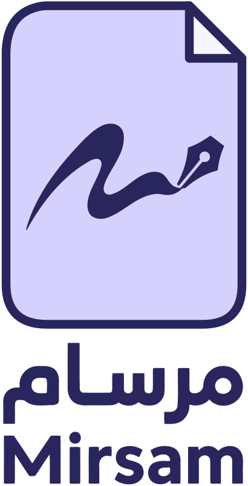

  <picture>
    <source media="(prefers-color-scheme: dark)" srcset="docs/brand/mirsam-logo-dark.svg">
    
  </picture>

# Mirsam (مرسام) — PDF viewer & editor

A desktop PDF viewer and editor aiming at Acrobat-class capability with three differences: it is
fast, it treats Arabic and mixed Arabic/English documents as first-class, and its OCR is built to
be trusted. Offline by default.

- **What we are building and why:** [docs/SPEC.md](docs/SPEC.md)
- **Where we are:** [PROGRESS.md](PROGRESS.md)
- **Why it is built this way:** [docs/adr/](docs/adr/README.md)
- **How to work in this repo:** [CLAUDE.md](CLAUDE.md)
- **See it run:** [the viewer (Milestone 1)](docs/demos/m1.md) ·
  [foundations (Milestone 0)](docs/demos/m0.md)

## What it does

**[v0.1.0](https://github.com/adrianazizx/Mirsam/releases/tag/v0.1.0)** is the first release, for
macOS, Windows and Linux, with its interface in English and in Arabic (right to left):

- **Read:** fast scrolling through long documents, thumbnails, outline, tabs, recent files,
  reading themes, password-protected files, printing; search and copy that get Arabic right.
- **Annotate and organize:** highlights and other markup, notes, text boxes, drawing, a comments
  panel; reorder, rotate, delete, merge, split and extract pages.
- **Edit:** add text, and edit the page's own text in place, in Arabic and English; images, links,
  headers, footers and page numbers; find and replace.
- **Forms and signing:** fill and create forms, Fill & Sign, drawn or typed signatures, certificate
  signatures (PAdES), passwords and permissions, true redaction.
- **OCR on your computer:** makes scanned Arabic and English documents searchable or editable,
  with a review of uncertain words. Its models are an optional download; nothing is sent anywhere.
- **Convert:** export pages as images, text or Markdown; compress files.

What is still open is in [PROGRESS.md](PROGRESS.md).

Mirsam was called Safha (صفحة) while it had a working name. Code identifiers were renamed to
`mirsam` on 2026-11-23; older ADRs and session notes still say `safha`.

The logo, the app icon and the pen-nib mark are in [docs/brand/](docs/brand/README.md).

## Download

Installers for macOS, Windows and Linux are on
[GitHub Releases](https://github.com/adrianazizx/Mirsam/releases/latest).

- **[Code signing policy](docs/CODE_SIGNING_POLICY.md):** Windows releases are signed through the
  SignPath Foundation's free programme for open-source projects (free code signing provided by
  [SignPath.io](https://about.signpath.io/), certificate by
  [SignPath Foundation](https://signpath.org/)); macOS releases are signed with the maintainer's
  Apple Developer ID. Each release's notes say if any of its installers are not yet signed.
- **[Privacy](docs/PRIVACY.md):** no accounts and no telemetry. Mirsam connects to the internet
  only when you ask it to.

## Licence

Mirsam is released under the [MIT licence](LICENSE). Third-party components keep their own
licences, listed in [THIRD_PARTY_LICENSES.md](THIRD_PARTY_LICENSES.md).
