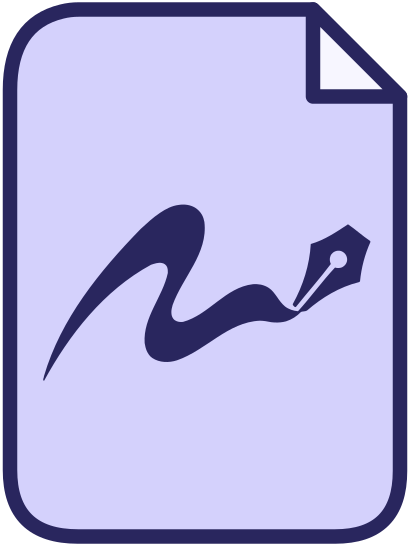
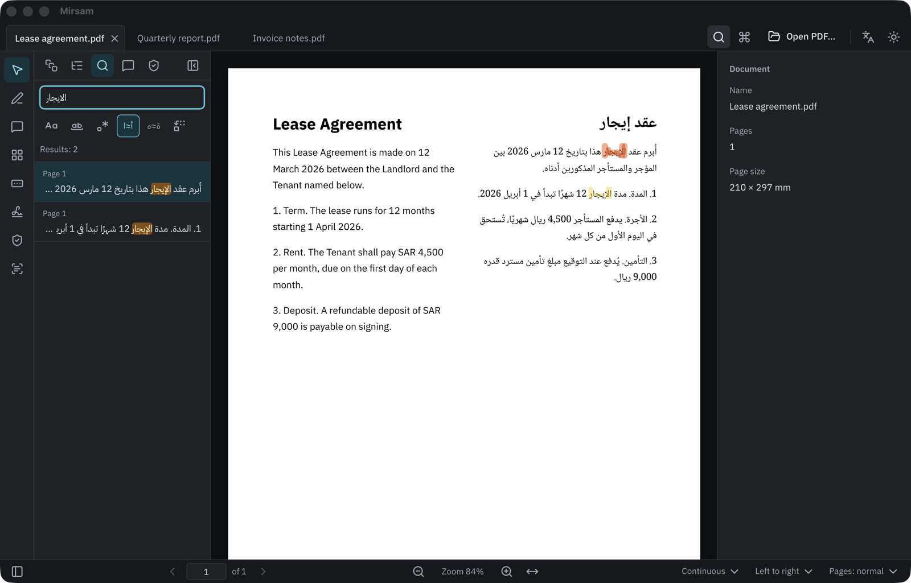
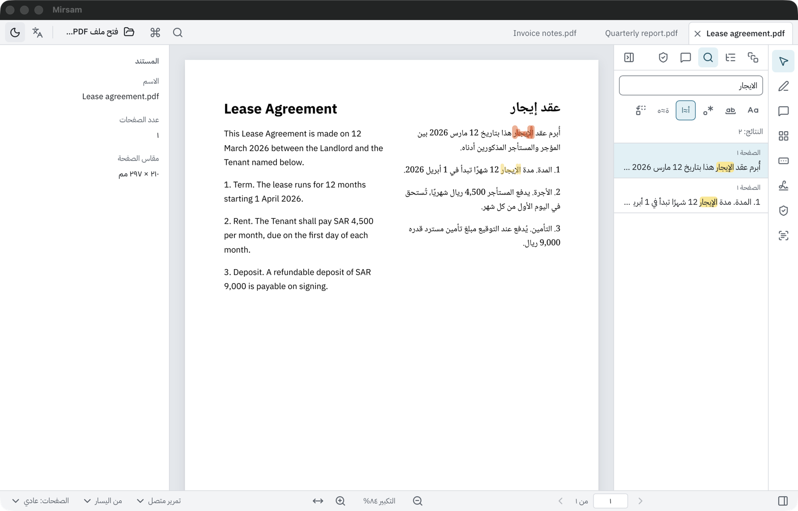
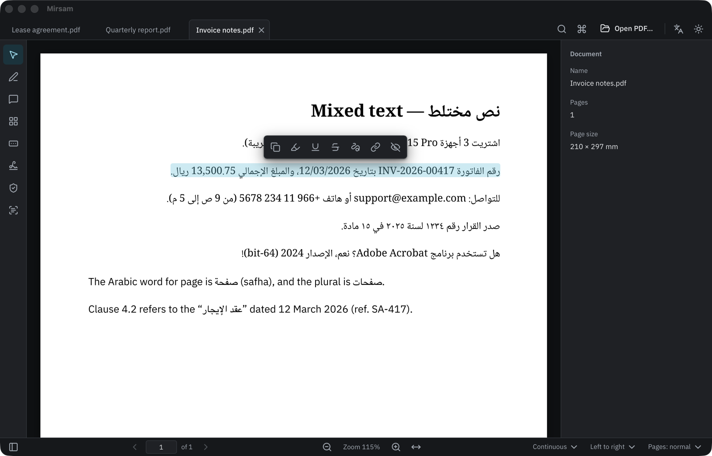
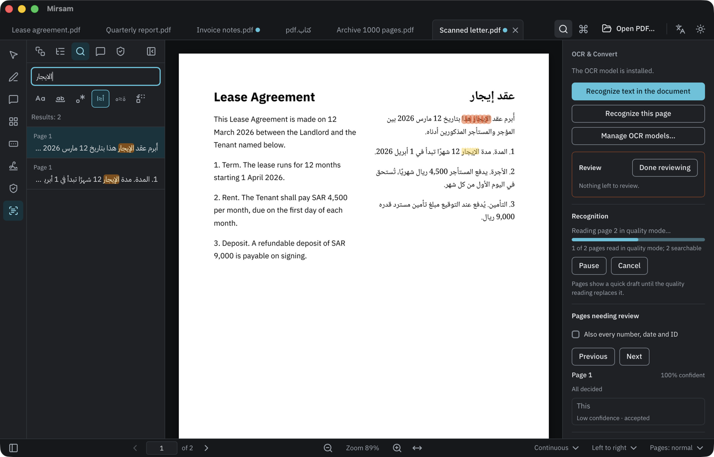
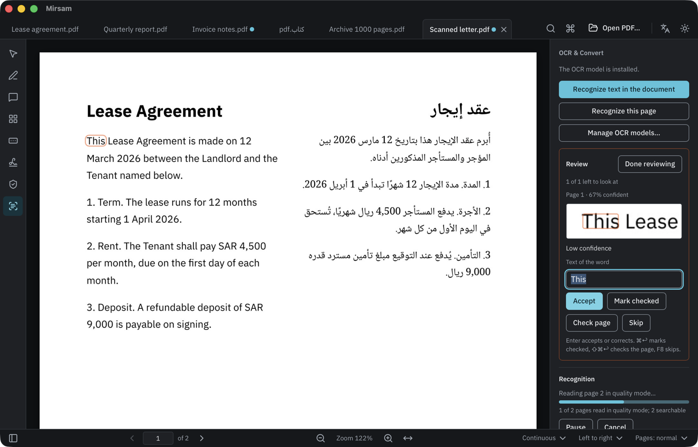
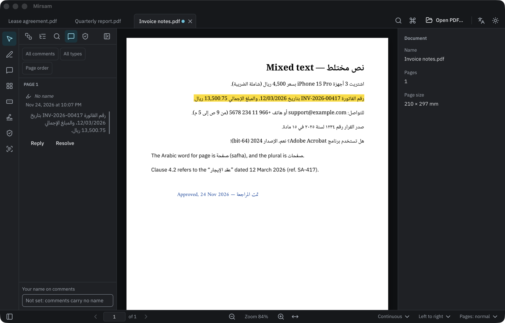
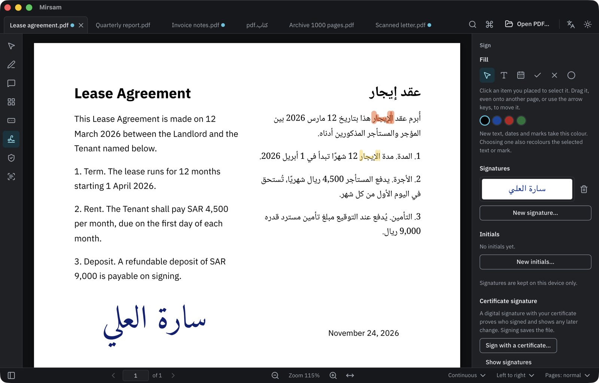

<p align="center">
  
</p>

<h1 align="center">Mirsam · مرسام</h1>

<p align="center">
  <b>The PDF editor that reads, writes and searches Arabic properly.</b><br>
  Fast, private, free, and built for documents that mix Arabic and English on the same line.
</p>

<p align="center">
  <a href="https://github.com/adrianazizx/Mirsam/releases/latest"></a>
  
  
  <a href="LICENSE"></a>
</p>

<p align="center">
  <a href="https://github.com/adrianazizx/Mirsam/releases/latest/download/Mirsam-macOS.dmg"><b>Download for Mac</b></a> ·
  <a href="https://github.com/adrianazizx/Mirsam/releases/latest/download/Mirsam-Windows-Setup.exe"><b>Download for Windows</b></a> ·
  <a href="#download"><b>Linux and other installers</b></a>
</p>

<p align="center">
  
</p>
<p align="center"><sub>A search for <code>الايجار</code> typed without the hamza finds <code>الإيجار</code> in a bilingual contract.</sub></p>

---

## Why Mirsam exists

Arabic is written and read by hundreds of millions of people, and their contracts, invoices and
forms usually mix in English names, reference numbers, dates and amounts. Mainstream PDF tools
still stumble on those documents in the same ways:

- typed Arabic comes out as **disconnected letters** in form fields and Fill & Sign;
- copied text comes out **reversed**, with numbers and English words in the wrong place;
- search **misses words** written with or without a hamza, or with Arabic-Indic digits;
- OCR of Arabic scans is weak, so you end up **double-checking every line**;
- and the software itself is slow to start, busy with menus and upsells, and often wants an
  account and a subscription.

Mirsam is a desktop PDF viewer and editor built the other way round. Arabic is part of every
feature from its first version, not a later add-on. Every text feature is tested in both
directions, with the whole interface also available in Arabic, mirrored right to left.

| | |
|---|---|
| 🌍 **Arabic and English, together** | Shaping, bidi and reading order handled correctly in viewing, search, copy, editing, forms, signatures and OCR. |
| 🔍 **OCR you can trust** | Scans become searchable and editable text on your own computer, and the words it isn't sure of are shown to you, not guessed. |
| ⚡ **Fast** | Opens in about half a second; a 1,000-page file scrolls at 60 fps. |
| 🔒 **Private** | No account, no telemetry, no ads. It connects to the internet only when you ask it to. |
| 🆓 **Free and open source** | MIT licence. Every installer is built in public CI. |

## Arabic that just works

<p align="center">
  
</p>

Switch the interface to Arabic and the entire window mirrors: the tool rail, panels, tabs and
status bar move to the other side, and Arabic-Indic digits appear in the interface. Underneath,
the same care goes into the text itself:

- **Search that understands Arabic.** Alef forms (`ا` `أ` `إ` `آ`) match each other, `٢٠٢٦`
  finds `2026`, and you can treat `ة` and `ه` as one letter. Whole words, case and regular
  expressions are there too.
- **Copy that keeps reading order.** Select a line that mixes `INV-2026-00417`, a date and an
  amount in riyals, paste it anywhere, and it reads exactly as it does on the page.
- **Right-to-left books.** Files that ask for it open as right-to-left two-page spreads, and the
  page order is a setting of its own, independent of the interface language.

<p align="center">
  
</p>

## OCR you can trust

Scanned documents are where most PDF tools give up on Arabic. Mirsam treats OCR as a headline
feature, and where accuracy and speed pull apart, it chooses accuracy.

<p align="center">
  
</p>

- **Searchable within moments.** A quick draft makes every page searchable almost at once
  (Apple Vision on macOS); then each page is read again by the quality pipeline in the
  background while you keep working.
- **Two readers, checked against each other.** A 4-billion-parameter Arabic OCR model reads each
  page; a second model re-reads every number, date, ID and every unsure word, and the pipeline
  only corrects text when the readings agree. It never invents words to fill a gap.
- **Measured, not promised.** On the project's 47-page evaluation set (generated Arabic, English
  and mixed pages, tables, degraded faxes and photocopies) the pipeline scores a **0.60 % character error rate**, reads
  **99.4 % of numbers, dates and IDs** exactly, and makes **no reading-order errors** on mixed
  lines. Every OCR change is gated on these numbers in CI.
- **Uncertain words come to you.** Words the readers disagree on are listed with their
  confidence. Choose one and Mirsam opens the page with the word marked, next to a crop of the
  scan, so checking a document takes seconds instead of a full proofread.
- **Nothing leaves your computer.** The models run locally (llama.cpp). They are an optional
  one-time download of about 5.5 GB, managed from Settings.

<p align="center">
  
</p>

The output is a normal PDF: an invisible text layer sits over the untouched image, it reads back
in logical order, and Undo takes it off again. You can also turn a recognised scan into editable
text.

## Edit, annotate and sign

<p align="center">
  
</p>

- **Edit the page itself.** Change a paragraph's own text in place, or add new text in Arabic and
  English with connected letters and a real Naskh face. Move text, move and resize images, add
  and change links; add headers, footers and page numbers; find and replace across the document.
- **Mark it up.** Highlights, underlines, notes, text boxes and drawings, with a comments panel
  for replies and resolving.
- **Organise pages.** Reorder, rotate, duplicate, delete, merge, split and extract, all
  undoable.
- **Forms and signatures.** Fill and create forms; Fill & Sign with drawn, typed or image
  signatures; certificate signatures (PAdES); passwords and permissions; and true redaction that
  removes the text from the file, not just from view.

<p align="center">
  
</p>

## Fast, and it stays fast

Speed is treated as a feature, with budgets checked in CI. Measured on release builds
(Apple M3 Max):

| | Budget | Measured |
|---|---|---|
| Launch to a usable window | ≤ 1.5 s | **≈ 0.5 s** |
| First page of a 100-page PDF on screen | ≤ 300 ms | **20–30 ms** |
| Scrolling and zooming a 1,000-page file | 60 fps | **60 fps**, nothing left blank |
| Memory with 1,000 pages open | < 500 MB | **315 MB** |
| Search across 500 pages | ≤ 1 s | **≈ 10 ms** |
| Typing while editing | ≤ 32 ms | **16–17 ms** |

Long documents open without loading every page, and OCR runs in the background, so the document
stays usable while it works. Every action is
also in the command palette (`⌘K` / `Ctrl+K`), searchable by its English or Arabic name.

## Everything in v0.1.0

- **Read:** tabs and windows, thumbnails, outline, page labels, recent files and session restore,
  single, two-page and book layouts, sepia and night page themes, password-protected files,
  printing.
- **Annotate and organise:** markup, notes, text boxes, drawing, comments; page reorder, rotate,
  delete, insert, merge, split and extract.
- **Edit:** in-place text editing and new text in Arabic and English; images, links, headers,
  footers and page numbers; find and replace.
- **Forms and signing:** fill and design forms, Fill & Sign, certificate signatures (PAdES),
  passwords and permissions, true redaction.
- **OCR:** searchable PDFs, review of uncertain words, re-reading an area, scan to editable text.
- **Convert:** export pages as images, text or Markdown; compress files.
- **Everywhere:** light and dark themes, full keyboard access, screen-reader labels, undo and
  redo, recovery of unsaved work, and safe saves that never leave a half-written file.

What is still open is tracked in [PROGRESS.md](PROGRESS.md).

## Download

| Platform | Installer |
|---|---|
| macOS 13+ (Apple silicon and Intel) | [Mirsam-macOS.dmg](https://github.com/adrianazizx/Mirsam/releases/latest/download/Mirsam-macOS.dmg) |
| Windows 10/11, 64-bit | [Mirsam-Windows-Setup.exe](https://github.com/adrianazizx/Mirsam/releases/latest/download/Mirsam-Windows-Setup.exe) · [.msi](https://github.com/adrianazizx/Mirsam/releases/latest/download/Mirsam-Windows.msi) for managed installs |
| Ubuntu, Debian | [Mirsam-Linux-x86_64.deb](https://github.com/adrianazizx/Mirsam/releases/latest/download/Mirsam-Linux-x86_64.deb) |
| Fedora, openSUSE | [Mirsam-Linux-x86_64.rpm](https://github.com/adrianazizx/Mirsam/releases/latest/download/Mirsam-Linux-x86_64.rpm) |
| Other Linux | [Mirsam-Linux-x86_64.AppImage](https://github.com/adrianazizx/Mirsam/releases/latest/download/Mirsam-Linux-x86_64.AppImage) |

Every release, with its notes and checksums, is on
[GitHub Releases](https://github.com/adrianazizx/Mirsam/releases).

- **[Code signing policy](docs/CODE_SIGNING_POLICY.md):** macOS releases are signed with the
  maintainer's Apple Developer ID and notarized. Windows releases are signed through the SignPath
  Foundation's free programme for open-source projects (free code signing provided by
  [SignPath.io](https://about.signpath.io/), certificate by
  [SignPath Foundation](https://signpath.org/)). Each release's notes say if any of its
  installers are not yet signed.
- **[Privacy](docs/PRIVACY.md):** no accounts and no telemetry. Mirsam connects to the internet
  only when you ask it to, for example to download the OCR models.

## How it's built

A Rust engine on top of [PDFium](https://pdfium.googlesource.com/pdfium/) (the PDF engine in
Chrome), a React interface, and [Tauri 2](https://tauri.app/) holding them together in a small
native app. The engine (`crates/mirsam-core`) has no UI code, so everything it does is tested
headless, including round trips that reopen every file Mirsam writes and check its text in
logical order.

- **What we are building and why:** [docs/SPEC.md](docs/SPEC.md)
- **Where we are:** [PROGRESS.md](PROGRESS.md)
- **Why it is built this way:** [the decision records](docs/adr/README.md)
- **Working in this repository** (setup, commands, conventions): [CLAUDE.md](CLAUDE.md)
- **Guided demos:** [the viewer](docs/demos/m1.md) · [page organising](docs/demos/m2.md) ·
  [text editing](docs/demos/m3.md) · [OCR](docs/demos/m4.md)

To run it from source:

```bash
scripts/dev-setup.sh                       # fetches PDFium
(cd apps/desktop && pnpm install)
cd apps/desktop && pnpm tauri dev
```

You need Rust (pinned in `rust-toolchain.toml`), Node 24 and pnpm 9. Contributions are welcome:
the rule of the house is that any change involving text works in **both English (left to right)
and Arabic (right to left)** before it is done.

Mirsam was called Safha (صفحة) while it had a working name. Code identifiers were renamed to
`mirsam` on 2026-11-23; older decision records and session notes still say `safha`.

The logo, the app icon and the pen-nib mark are in [docs/brand/](docs/brand/README.md).

## Licence

Mirsam is released under the [MIT licence](LICENSE). Third-party components keep their own
licences, listed in [THIRD_PARTY_LICENSES.md](THIRD_PARTY_LICENSES.md).

<p align="center"><sub>Screenshots show the v0.1.0 release on macOS, opened on the project's generated test documents.</sub></p>
